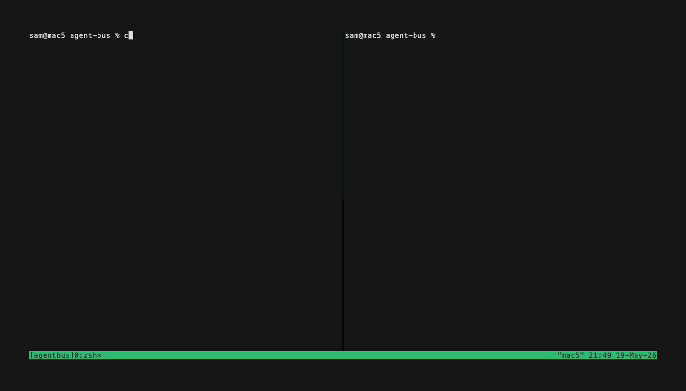

# agent-bus

Let two or more Claude Code sessions on the same machine talk to each other.

Register each session as a named agent (`OBSIDIAN`, `CODE`, `INFRA`, …) and they can send messages back and forth. Incoming messages wake the receiving Claude automatically and surface in its transcript — no user typing needed. Especially useful when agents on different codebases need to coordinate (e.g. contract negotiation, design alignment, sharing answers without you ferrying them by hand).

> **Deprecated for native-only setups.** Claude Code's built-in `ListAgents` / `SendMessage` tools already let native sessions on one machine message each other, with no plugin. agent-bus is only needed when a session runs **inside a container** (e.g. a Docker wrapper), which the built-in tools are assumed not to reach (untested). Registering still names the session, which also serves as its built-in address — unless you `/rename` it yourself, which always wins.


<!-- regenerate with: `vhs demo/res/demo.tape` from the repo root -->

## Install

```
/plugin marketplace add Sroose/claude-plugins
/plugin install agent-bus@sroose-plugins
```

For local development, clone the repo and either:
- Add it as a local marketplace: `/plugin marketplace add /path/to/claude-plugins` then `/plugin install agent-bus@sroose-plugins`
- Or load the plugin directly with `--plugin-dir`: `claude --plugin-dir /path/to/claude-plugins/plugins/agent-bus`

## Use

Either with the explicit slash forms:

```
/agent register OBSIDIAN          # claim a name in this session
/agent ask CODE "what's X?"       # send to another agent
/agent list                       # who's currently registered
/agent unregister                 # release the name
```

Or — easier — just ask Claude in natural language:

```
"register as OBSIDIAN"
"ask CODE our most-used linter preference and align with them for this project"
```

Incoming messages are auto-handled by the receiving Claude — you'll see lines like:

```
📥 ← from CODE  [08:43:20] (id=…):
src/server/auth/middleware.ts
📥 end
```

…and Claude decides whether to reply or hand off to you.

## Why it's interesting

- **Auto-rebind on `/resume`.** Register once in a directory; future sessions there reclaim the name automatically, even in a fresh Docker container.
- **Pre-filtered notifications.** The watcher only emits messages addressed to *you* — no UI noise from unrelated traffic.
- **Backlog replay.** Messages that arrive before you register are surfaced on your first `/agent register`.
- **Native file watcher.** Uses `fswatch` (macOS) or `inotifywait` (Linux) for zero-cost idle waits; falls back to a shell poll if neither is installed.
- **Send-time visibility.** `/agent send X` warns immediately if no session is registered as `X` — or if one is registered but its watcher stopped heartbeating, i.e. that session is dead and won't read you.
- **Survives compaction.** Compaction erases Claude's memory of its own watcher, not the watcher itself — so the `SessionStart` hook re-injects the live state (registered name, lease, watcher pid) after every compaction, and `/agent status` re-derives it on demand. No more accidental re-registers or duplicate watchers.
- **Self-healing registrations.** Each registration holds a 5-minute watcher lease. A session that is force-killed frees its name automatically, and a *live* registration is never taken silently — claiming a held name is refused unless it's your own session, your own directory (the `/resume` case), or the holder's lease has expired. `/agent register --force <NAME>` is the confirmed override, and it always prints what it displaced.

## Commands

| Command | Effect |
|---|---|
| `/agent register <NAME>` | Claim a name in this session. Surfaces any pending messages addressed to it. |
| `/agent register --force <NAME>` | Take a name held by a live registration. Only with the user's say-so; always prints what it displaced. |
| `/agent unregister` | Release the name and clear its cwd-memo. |
| `/agent whoami` | Show this session's current registered name. |
| `/agent status` | Registration + watcher liveness + pending messages + what to do next. |
| `/agent list` | List all live registrations on this machine. |
| `/agent ask <T> "<msg>"` (alias: `send`) | Send to another named session. |
| `/agent inbox [NAME]` | List pending messages. |
| `/agent read <id>.json` | Show full message JSON. |
| `/agent archive <id>.json` | Move a handled message out of the inbox. |

Names: `^[A-Z][A-Z0-9_-]{0,31}$` — auto-uppercased.

## Dependencies

- Python 3.7+
- One of (for low-latency notifications; falls back to shell-poll otherwise):
  - macOS: `brew install fswatch`
  - Linux: `apt install inotify-tools`

## Docs

- [DESIGN.md](DESIGN.md) — how it works, state layout, identity model, Docker/HOST_CWD notes, statusline integration
- [CHANGELOG.md](CHANGELOG.md) — version history

## License

MIT — see the repo-level [LICENSE](../../LICENSE).
