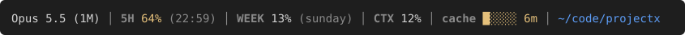

# better-statusline

A richer Claude Code status line:



One compact line:

```
Opus 5.5 (1M) │ 5H 2% (22:59) │ WEEK 13% (sunday) │ CTX 12% │ cache █████ 59m │ ~/code/projectx
```

- **Model** in use (`(1M context)` shortened to `(1M)`)
- **5H**: 5-hour rate-limit usage + the clock time it resets
- **WEEK**: weekly rate-limit usage + reset day
- **CTX**: context-window % used
- **cache**: prompt-cache countdown with a 5-cell bar (needs Claude Code ≥ 2.1.251, which passes
  `prompt_cache` to the status line; the segment is omitted on older versions)
- **Working directory**, `~`-shortened and an OSC 8 `file://` link, so cmd-click opens it in
  Finder in terminals that support it (Ghostty, iTerm2, WezTerm, …). With `$HOST_CWD` set
  (containerized sessions) the host path is shown in parens and is the link target.

Labels and scaffolding are grey; only values carry color. Percentages turn yellow at ≥ 60% and
red at ≥ 80%. The cache turns yellow in the last 20% of its TTL (1h tier: 12 min; 5m tier:
60 s), red in the last 5%, and shows `cold` once expired.

## Install

```
/plugin marketplace add Sroose/claude-plugins
/plugin install better-statusline@sroose-plugins
/reload-plugins
/better-statusline:apply
```

`/better-statusline:apply` adds the `statusLine` entry to your `~/.claude/settings.json` for
you (it asks first if you already have a different status line configured). The status line
appears on the next render — no restart needed.

## How it's wired

Claude Code can't set a `statusLine` automatically when a plugin is enabled — that key isn't
among the ones a plugin's bundled `settings.json` is allowed to contribute, and plugin install
runs no setup step. So the `apply` command does it on your explicit request.

The `statusLine.command` it writes is a self-contained resolver:

```sh
sh -c 'f=$(ls -1 "$HOME"/.claude/plugins/cache/*/better-statusline/*/lib/statusline.py 2>/dev/null | sort -V | tail -1); [ -n "$f" ] || exit 0; command -v python3 >/dev/null 2>&1 || { echo "[better-statusline: python3 not found]"; exit 0; }; exec python3 "$f"'
```

It runs the newest installed copy of [`lib/statusline.py`](lib/statusline.py) from the plugin
cache. A bare `better-statusline` command can't be used here because a plugin's `bin/` is only
on the Bash *tool's* PATH, not the status-line subprocess's PATH. Resolving from the cache means
the line keeps working across plugin updates. It degrades gracefully: prints nothing if the
plugin is disabled/uninstalled, and shows `[better-statusline: python3 not found]` if `python3`
isn't on PATH (rather than a silent blank line). It always exits 0 so the status-line subsystem
never errors.

`refreshInterval: 30` makes Claude Code re-run the script every 30 s, so the cache countdown
keeps moving while you're idle. That's a local re-render: no API call, no tokens.

## Uninstall

Remove the `statusLine` block from `~/.claude/settings.json`, then
`/plugin uninstall better-statusline@sroose-plugins`.

## Requires

`python3` on PATH.
